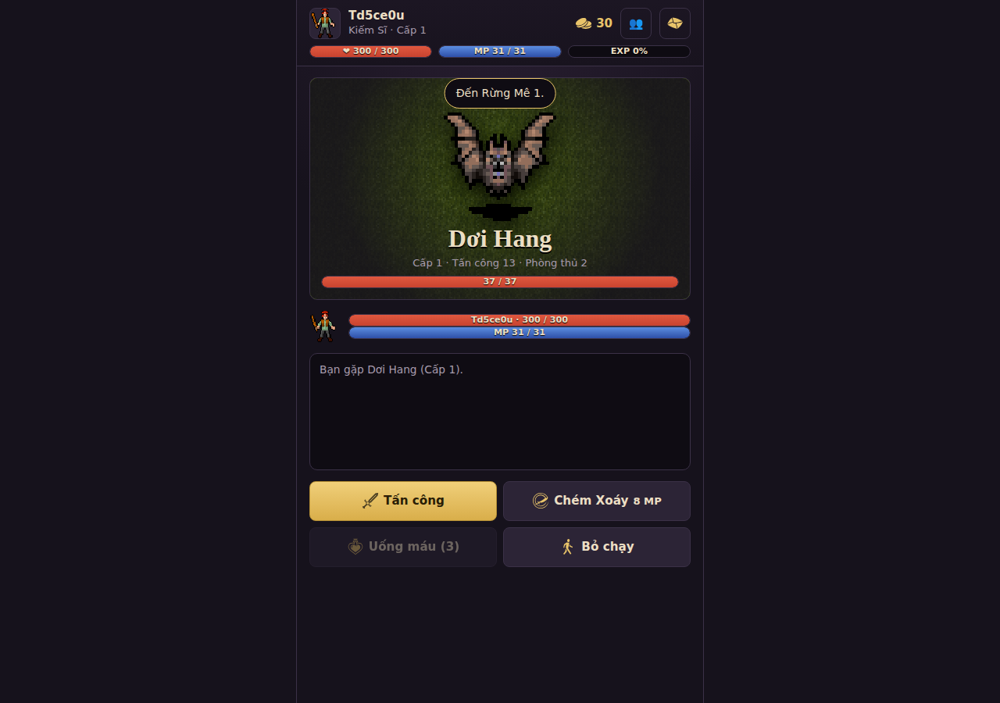
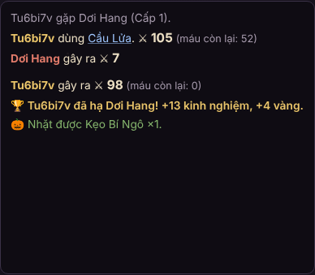
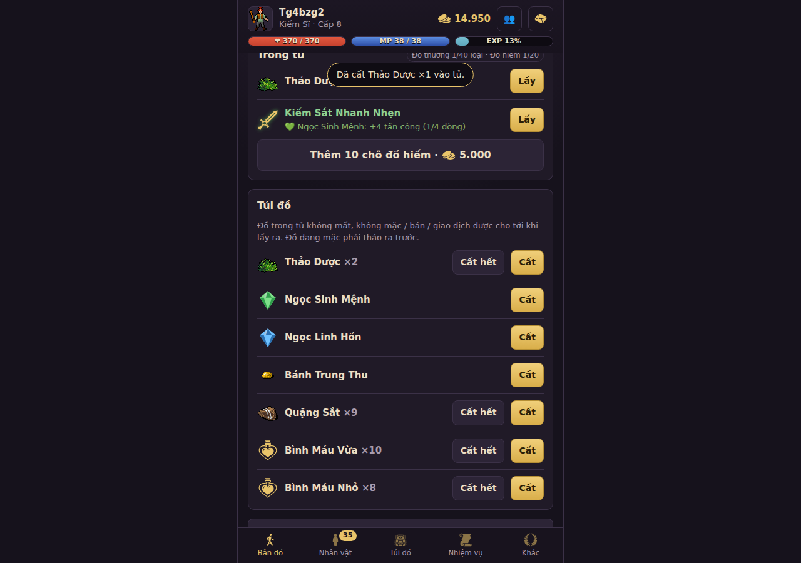
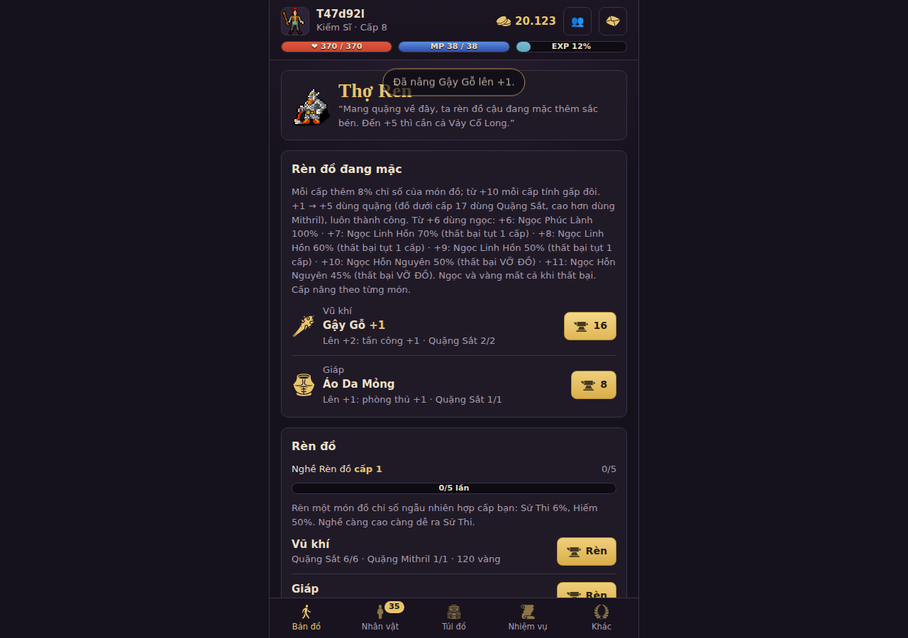
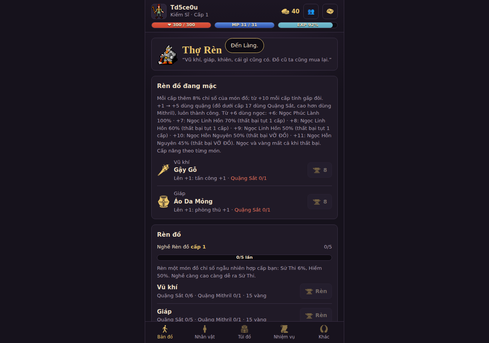
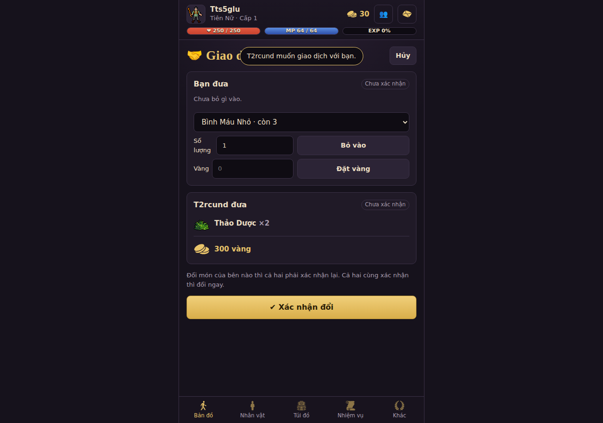
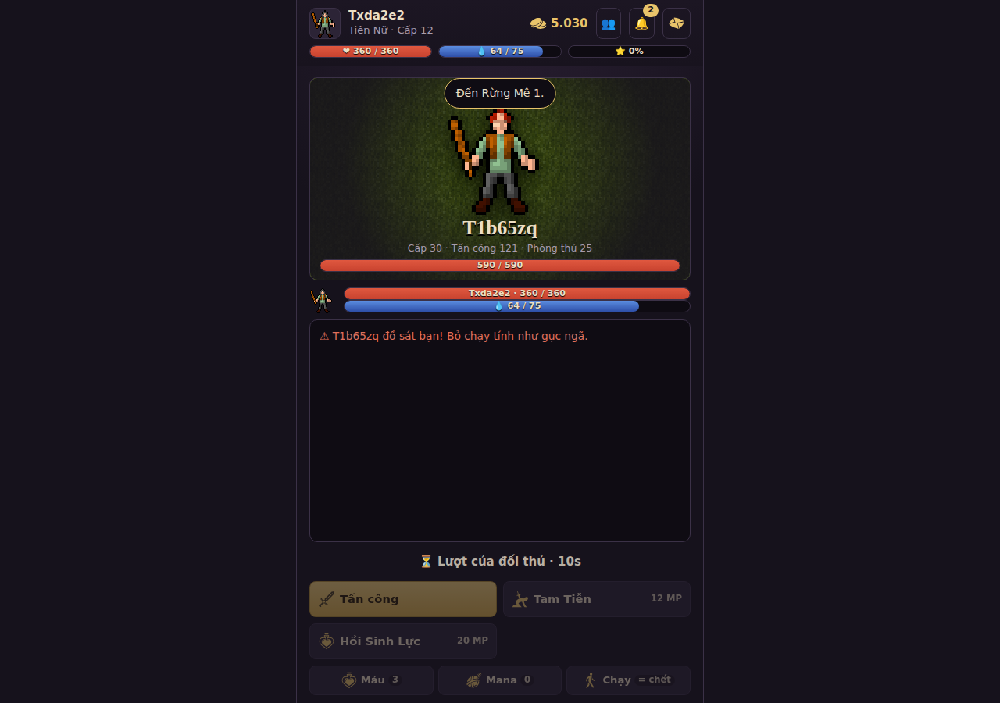
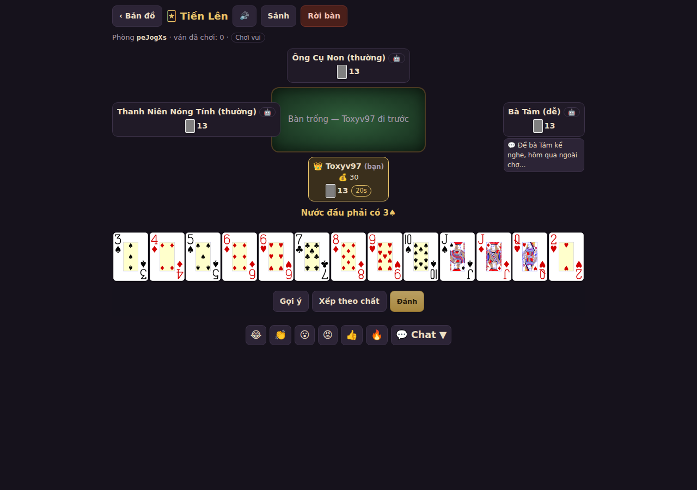
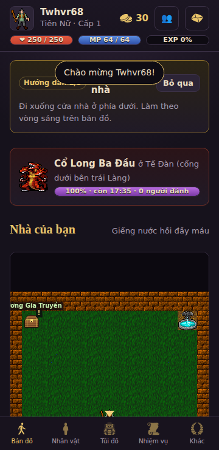

# Hướng dẫn người chơi — Hắc Long

> Hắc Long là game nhập vai chơi trên trình duyệt (máy tính và điện thoại). Rèn luyện qua sáu vùng đất, hạ các trùm canh
> giữ và tiêu diệt Hắc Long. Số liệu trong hướng dẫn này là số hiện tại của server; quản trị viên có thể chỉnh.

## Mục lục

1. [Bắt đầu](#1-bắt-đầu)
2. [Bốn lớp nhân vật](#2-bốn-lớp-nhân-vật)
3. [Chỉ số và lên cấp](#3-chỉ-số-và-lên-cấp)
4. [Bản đồ, vùng đất, trùm](#4-bản-đồ-vùng-đất-trùm)
5. [Đánh nhau](#5-đánh-nhau)
6. [Đồ đạc, túi, Tủ Đồ](#6-đồ-đạc-túi-tủ-đồ)
7. [Ép đồ, ngọc, Máy Hỗn Nguyên, cánh](#7-ép-đồ-ngọc-máy-hỗn-nguyên-cánh)
8. [Làng: NPC và việc hằng ngày](#8-làng-npc-và-việc-hằng-ngày)
9. [Thủ Kho, thú cưng, câu cá, nấu ăn](#9-thủ-kho-thú-cưng-câu-cá-nấu-ăn)
10. [Chơi cùng người khác](#10-chơi-cùng-người-khác)
11. [Đấu trường và Đồ sát](#11-đấu-trường-và-đồ-sát)
12. [Bang hội và chiến bang](#12-bang-hội-và-chiến-bang)
13. [Hộp thư, Thông báo, bảng xếp hạng](#13-hộp-thư-thông-báo-bảng-xếp-hạng)
14. [Phím tắt, điện thoại](#14-phím-tắt-điện-thoại)

> **Lịch sự kiện** (Golden Invasion, Quảng Trường Quỷ, Lâu Đài Máu, Hỗn Chiến Thành, Kalima, Công Thành Chiến, Rồng Đỏ / Phù Thủy Trắng xâm lăng, trùm thế giới, lễ hội, việc hằng ngày) và cách tham gia: xem [`EVENTS.md`](EVENTS.md). Cày hay mua vật phẩm, xấp xỉ bao nhiêu quái: [`ECONOMY.md`](ECONOMY.md).

---

## 1. Bắt đầu

- **Ngôn ngữ / Language:** nút English / Tiếng Việt ở trang đăng nhập và trong Menu → Cài đặt.
- Đăng ký tài khoản (tên đăng nhập + mật khẩu + **câu hỏi bảo mật** và câu trả lời), đặt tên nhân vật (2–16 ký tự) và chọn lớp.
- **Nhiều nhân vật:** mỗi tài khoản tối đa 5 nhân vật, chơi một nhân vật một lúc. Như MU, mở game (tab / ứng dụng mới) hoặc đăng
  nhập thì hiện **màn chọn nhân vật** (theo thứ tự tạo); F5 / mất mạng nối lại thì vào thẳng nhân vật đang chơi. Đổi ở
  Menu → Cài đặt → **Đổi nhân vật**. Thùng đồ ở **Thủ Kho** (đồ, vàng, chỗ mở rộng) dùng
  chung mọi nhân vật; Rương Gia Truyền và quà quản trị gửi mọi người mỗi tài khoản một phần. Bạn bè, bang, thư, chợ, đồ sát
  tính riêng từng nhân vật. Xóa nhân vật phải gõ lại tên và mật khẩu; đồ trên nhân vật đó mất hẳn (thùng chung giữ nguyên).
  Vào nhân vật khác ở máy / tab khác thì máy / tab đang chơi về màn chọn nhân vật.
- **Quên mật khẩu:** ở màn đăng nhập bấm "Quên mật khẩu?", nhập tên đăng nhập, trả lời câu hỏi bảo mật (không phân biệt
  chữ hoa / thường) và đặt mật khẩu mới là vào game luôn; các thiết bị khác bị đăng xuất. Trả lời sai 5 lần thì phải đợi một
  giờ. Tài khoản cũ chưa có câu hỏi (hoặc quên câu trả lời) thì gửi yêu cầu cho quản trị như trước. Đổi / đặt câu hỏi ở
  Menu → Cài đặt → Câu hỏi bảo mật (cần mật khẩu hiện tại).
- Bạn bắt đầu ở **Làng** (cạnh Đá Dịch Chuyển). Lần đầu chơi có **hướng dẫn tân thủ** (khung vàng phía trên bản
  đồ) dẫn từng bước và tặng quà khi xong; bấm "Bỏ qua" nếu không cần.
- Chạm (hoặc bấm) vào một ô trên bản đồ để đi tới; bước vào quái để đánh; bước vào NPC để nói chuyện.
- Thanh trên cùng (HUD): tên, cấp, vàng, máu (đỏ), MP (xanh), kinh nghiệm; nút 👥 bạn bè, 🔔 thông báo, ✉ hộp thư.
- Thanh dưới cùng (dock): **Bản đồ**, **Nhân vật**, **Túi đồ**, **Chọn map** (sắp có), **Menu** (Nhiệm vụ — có thẻ "Mục tiêu kế tiếp" và giờ trùm thế giới, Đấu trường,
  Xếp hạng, Bang hội, Thành tựu, Thú cưng, Kỹ năng, Sổ quái, **Cài đặt**: âm thanh, nhạc, đăng xuất, đổi mật khẩu…). Phím **Tab** mở Menu.

## 2. Bốn lớp nhân vật

| Lớp | Lối chơi | Kỹ năng (cấp mở) |
|---|---|---|
| **Kiếm Sĩ** | Cận chiến, máu và thủ dày. Tấn công theo Sức mạnh | Chém Xoáy (1), Trảm Choáng (10), Nộ Chiến (25) |
| **Phù Thủy** | Phép mạnh, máu mỏng. Tấn công theo Năng lượng | Cầu Lửa (1), Tia Sét (10), Khiên Linh Hồn (25) |
| **Tiên Nữ** | Cung, hồi máu, tăng sức. Tấn công theo Nhanh nhẹn | Tam Tiễn (1), Hồi Sinh Lực (10), Tăng Sức Mạnh (25) |
| **Đấu Sĩ** | Lai kiếm và phép (Sức mạnh + Năng lượng) | Kiếm Lửa (1), Kiếm Độc Hỏa (10), Phán Quyết (25) |

Kỹ năng tốn MP, tốn nhiều hơn khi lên cấp (MP gốc × (1 + 2 % × (cấp − 1))). Mỗi lượt trong trận hồi 3 % MP tối đa + Năng lượng / 10; nghỉ trọ hồi đầy. Kỹ năng luôn trúng (đòn thường có thể trượt).

**Thông thạo kỹ năng:** mỗi kỹ năng có cấp 1–10, luyện bằng cách dùng khi đánh quái (+2 điểm mỗi lần, tự đánh +1, trùm / quái tinh anh ×3; quái thấp hơn mình quá 10 cấp và đánh người không tính). Cấp 1 gây 75 % sức của cấp 10, cấp thấp tốn thêm MP (dưới cấp 4), hồi chiêu chậm hơn 1 lượt (dưới cấp 7), tác dụng phụ yếu hơn (dưới cấp 10). Lên cấp 5 và cấp 10 cần **đột phá** ở Menu → Kỹ năng: 1 / 3 **Bí Kíp** (lần đầu hạ mỗi trùm vùng / chúa tể chắc chắn 1 cuốn, Tháp Vô Tận mỗi 10 tầng vượt lần đầu 1 cuốn; còn rơi từ trùm hạ lại, quái tinh anh, trùm thế giới) hoặc 5 / 15 Ngọc Tâm Linh. Nhân vật tạo trước bản cập nhật có sẵn cấp 10 cho mọi kỹ năng đang có.

Bình máu và **bình mana** (Bà Lang bán) hồi số cố định: bình máu nhỏ / vừa / lớn 60 / 400 / 1 800 máu, bình mana 25 / 120 / 400 MP, giá cố định 10 / 60 / 200 vàng. Bình vừa mua được từ cấp 10, bình lớn từ cấp 25 (đã chuyển sinh thì mua được cả ba). Trong trận có nút **Uống máu** và **Uống mana** (mất một lượt).

## 3. Chỉ số và lên cấp

- Mỗi cấp được điểm tiềm năng. Cộng điểm ở tab **Nhân vật** (bấm + nhiều lần rồi xác nhận một lần):
  - **Sức mạnh**: tấn công (Kiếm Sĩ, Đấu Sĩ).
  - **Nhanh nhẹn**: chí mạng, né, phòng thủ, tỉ lệ trúng; tấn công của Tiên Nữ.
  - **Thể lực**: máu tối đa.
  - **Năng lượng**: MP; tấn công của Phù Thủy, Đấu Sĩ.
- Bảng nhân vật hiện tấn công thấp ~ cao (ví dụ "68 ~ 84"), phòng thủ, tỉ lệ trúng quái cùng cấp.
- Đánh quái thấp hơn mình quá 10 cấp thì kinh nghiệm giảm (mỗi cấp −10 %, còn tối thiểu 10 %): hãy lên vùng mới.
- **Chuyển sinh**: đạt cấp tối đa thì gặp Trưởng Làng để về cấp 1, giữ đồ, vàng, vùng đã mở, nhận thêm điểm tiềm năng vĩnh viễn
  (25 điểm × số lần đã chuyển sinh). Mỗi lần đã chuyển sinh làm kinh nghiệm lên cấp cần thêm 25 % (lần 4: gấp đôi). Từ lần thứ hai,
  muốn chuyển sinh lần k + 1 phải từng hạ **chúa tể vùng chuyển sinh k** (vd chuyển sinh lần 2 cần hạ Chúa Tể Xích Viêm ở vùng 1).
  **Không giới hạn số lần**: sau 10 lần vẫn chuyển sinh tiếp được, mỗi lần phải hạ lại chúa tể vùng 10, chỉ thêm 10 điểm
  tiềm năng, kinh nghiệm như lần 10 (sự kiện, đồ sát tính như mốc 10).
  Mỗi vùng chuyển sinh có 5 bản đồ: bản đồ 1 là cửa vào (Đài Phúc Lành), cổng mép dưới dẫn vào bản đồ 2 → 5, càng sâu quái càng
  mạnh, cho nhiều kinh nghiệm và đồ hơn; chúa tể vùng đứng ở bản đồ 5.

## 4. Bản đồ, vùng đất, trùm

| Vùng | Cấp quái | Trùm |
|---|---|---|
| Rừng Mê | 1–5 | Sói Xám Đầu Đàn (6) |
| Trại Goblin | 6–11 | Tướng Orc (12) |
| Nghĩa Địa Cổ | 12–17 | Pháp Sư Bất Tử (18) |
| Núi Khổng Lồ | 18–23 | Vua Khổng Lồ (24) |
| Đầm Lầy Rồng | 24–29 | Kim Long (30) |
| Hang Hắc Long | 30–35 | **HẮC LONG** (36) |

- **Vùng mở theo cấp**: cấp nhân vật ≥ cấp quái thấp nhất của vùng là vào và đánh được, không cần hạ trùm trước.
- **Trùm vùng là thử thách có thưởng**: hạ lần đầu chắc chắn rơi một món đồ **đúng lớp có dòng cộng thêm +8 / +12** và nhận danh hiệu
  **Diệt <tên trùm>** (chọn ở tab Thành tựu); mỗi ngày lần đầu hạ một trùm được thêm ngọc (vùng 1–3: Ngọc Ước Nguyện,
  vùng 4–6: Ngọc Tâm Linh). Hạ Hắc Long vẫn là đích cuối, lên bảng **Diệt rồng**.
- Chạm vào **đá dịch chuyển** để ghi nhớ, sau đó dịch chuyển nhanh từ đó.
- Gặp trùm là vào trận ngay như quái thường.
- **50 bản đồ phụ** (cấp quái 1–50, 10 nhóm: Đồng Cỏ Xanh, Rừng Thưa, Gò Kiến Đỏ, Đầm Sương, Cao Nguyên Tuyết, Thung Lũng U Linh, Mộ Cổ Hoang, Lò Nguyên Tố, Đỉnh Khổng Lồ, Vực Quỷ): vào bằng cổng xanh ở mép phải Rừng Mê 1, Rừng Mê 2, Trại Goblin 1–2, Nghĩa Địa Cổ 2, Núi Khổng Lồ 1–2, Đầm Lầy Rồng 2, Hang Hắc Long 1–2; mỗi nhóm 5 bản đồ nối tiếp nhau.
- **Bản đồ mang chất Việt** (cổng xanh ở mép phải bản đồ cha):

  | Bản đồ | Cấp quái | Vào từ |
  |---|---|---|
  | Làng Chài Ven Biển (câu cá biển) | 8–10 | Trại Goblin 1 |
  | Chợ Nổi (không có quái, câu cá) | cần cấp 8 | Làng Chài |
  | Rừng Tre | 14–16 | Nghĩa Địa Cổ 1 |
  | Ruộng Bậc Thang (bản đồ lớn) | 20–24 | Núi Khổng Lồ 1 |
  | Đồng Bằng Sông Nước (bản đồ lớn) | 26–30 | Đầm Lầy Rồng 1 |
  | Đền Cổ Trên Núi | 34–38 | Hang Hắc Long 2 |

  Nghe nói sau bức tường Đền Cổ có một hang động chỉ mở vào vài đêm… Hỏi Lão Từ Giữ Đền xem đêm nay có mở không (cần
  cấp 38). Trong động tối om, có quái Tinh Anh (viền tím) mạnh hơn nhưng thưởng gấp đôi, và một con trùm thức giấc lúc nửa
  đêm. Gần sáng đá bắt đầu rơi, 5 giờ động sụp và đẩy mọi người ra. Tên người tìm ra động đầu tiên mỗi đêm và người hạ trùm
  được khắc lên Bia ở Đền Cổ.
- **Bản đồ thế giới**: Chọn map → **🌐 Thế giới** (hoặc bấm bản đồ thu nhỏ ở góc khung bản đồ) xem các bản đồ nối nhau thế
  nào, màu theo độ khó so với cấp mình; bấm bản đồ đã mở để dịch chuyển. Giữ và kéo bản đồ thu nhỏ để dời nó sang chỗ khác trong khung (máy nhớ vị trí);
  tắt bản đồ thu nhỏ ở Menu → Cài đặt.
- **Thời tiết** đổi mỗi giờ, cả server thấy như nhau (biểu tượng cạnh tên bản đồ): nắng, mưa, giông có chớp, sương mù, tuyết,
  bão tuyết… Khi đánh quái, kỹ năng cùng hệ với thời tiết mạnh hơn: quang → Ánh Sáng +5%, mưa / giông → Sét +5% / +10%,
  tuyết / bão tuyết → Băng +5% / +10%, sương → Bóng Tối +5%, lá bay → Gió +5%, gió cát → Đất +5%, tàn lửa → Lửa +5%
  (màn đánh ghi mức cộng; nút kỹ năng được cộng có viền sáng xanh). Đánh người không tính.
- **Thương Nhân Phương Xa** ở Chợ Nổi: mỗi ngày bày 4 món hiếm khác nhau (Mồi Rồng, Linh Chi, Quặng Mithril, Cá Chép Vàng,
  mảnh vé sự kiện, Bình Máu Lớn…), mỗi món mua được vài lần mỗi ngày.
- **Chọn bản đồ** (phím **M** hoặc nút **Chọn map** trên dock): đủ cấp (cấp nhân vật ≥ cấp quái thấp nhất của bản đồ) và đủ vàng là dịch chuyển được, tốn 20 + 4 × cấp quái thấp nhất (Làng miễn phí). Không cần mở vùng hay đi qua cổng trước.
- Ban đêm quái hiếm xuất hiện nhiều hơn. **Trùm thế giới Cổ Long** thỉnh thoảng xuất hiện ở Tế Đàn: cả server cùng đánh, thưởng
  theo sát thương (vắng mặt thì nhận qua thư).
- **Golden Invasion**: mỗi 2 giờ (0h, 2h, 4h… giờ Việt Nam) trong 15 phút, quái vàng (quầng vàng) xuất hiện ở bản đồ đầu
  mỗi vùng: mạnh hơn một chút, thưởng **×5**, dễ rơi ngọc, không hồi sinh. Hạ hết quái vàng một bản đồ thì **trùm vàng** xuất
  hiện (chắc chắn rơi ngọc). Dải vàng trên bản đồ cho biết giờ còn lại.
- **Tháp Vô Tận** (Người Gác Tháp ở Làng): mỗi tầng hạ hết quái để lên; cứ 5 tầng có trùm; máu không tự hồi trong tháp.
- **Quảng Trường Quỷ** (cấp 35+, 1h, 3h … 23h) và **Lâu Đài Máu** (cấp 40+, 0h30, 2h30 … 22h30), **Hỗn Chiến Thành** (cấp 15+, 1h30, 3h30 … 23h30): vào qua Người Gác Tháp, cần vé. Chi tiết: [`EVENTS.md`](EVENTS.md).
  Sự kiện **đánh chung theo phòng** như MU: Quảng Trường Quỷ, Lâu Đài Máu, Hỗn Chiến Thành chia phòng theo số lần chuyển sinh
  (0–1, 2–3, 4–5, 6–7, 8–9, 10+), cùng phòng thì chung quái, chung máu quái; Kalima theo tổ đội. Quái mạnh theo mốc **cao nhất**
  của phòng (Kalima: người chuyển sinh nhiều nhất trong tổ đội): mỗi mốc máu / thủ +40 %, công +15 %, kinh nghiệm / vàng +20 %
  (tối đa 10). Vương Miện cố định mốc 10; quái vàng, trùm thế giới và tháp không đổi.

## 5. Đánh nhau

- Trận theo lượt: **Đánh**, **Kỹ năng**, **Uống máu**, **Chạy**. Số bay lên cho biết sát thương; "Trượt" là đòn hụt.
- Đòn có khoảng thấp ~ cao, có thể chí mạng; thủ của mục tiêu làm giảm sát thương nhưng không xuống dưới 20 % đòn gốc.
- **Nhật ký trận**: mỗi lượt một khối; tên bạn màu vàng, quái màu đỏ; ⚔ sát thương, 💥 chí mạng, ❤ hồi máu; sau đòn của bạn có máu còn lại của quái.

  
- Thắng nhận kinh nghiệm, vàng, có khi rơi đồ hoặc ngọc. Gục ngã thì về Làng, mất 10 % vàng đang mang.
- **Hiệu ứng**: "LÊN CẤP" giữa màn hình khi lên cấp; số xanh khi hồi máu / MP; chữ lớn khi ép đồ thành công hay vỡ đồ.
- **Tự hủy đồ rơi** (Menu → Cài đặt): bật thì trang bị rơi ra không thuộc loại được chọn "Giữ lại" (Excellent, Thần, May mắn / Kỹ năng, nhiều dòng, tốt hơn đồ đang mặc, mặc được) bị hủy ngay, cả khi đánh tay lẫn tự đánh; nhẫn, dây chuyền, cánh, ngọc, nguyên liệu luôn giữ.
- **Tự đánh** (thanh 🤖 dưới bản đồ, chỉ khi đang mở game):
  - Bấm ⚙ (cài đặt kiểu MU Helper):
    - **Đánh**: tất cả quái (mặc định), quái không cao hơn mình (cấp ≤ cấp mình + 1), hoặc một loại trên bản đồ.
    - **Phạm vi săn**: cả bản đồ, hoặc chỉ quái trong 4 / 8 / 12 ô quanh chỗ bấm bắt đầu; hết quái thì quay về chỗ đó đứng chờ.
    - **Kỹ năng**: dùng bộ kỹ năng đang mang (kỹ năng buff tung trước), chỉ đòn thường (đỡ tốn mana), hoặc chỉ dùng kỹ năng với
      trùm / tinh anh / quái vàng / quái Bóng Đêm.
    - **Uống máu / mana** khi dưới bao nhiêu %.
    - **Đồ rơi**: giữ hết, hoặc chỉ giữ loại đã tích (Excellent, Đồ Thần, May mắn / Kỹ năng, từ 2 dòng cộng thêm, tốt hơn đồ
      đang mặc, mặc được); món khác bị hủy ngay sau trận. Ngọc, nguyên liệu, cánh, nhẫn, dây chuyền luôn giữ.
    - **Về mặc định** đưa mọi ô về như ban đầu. Cài đặt lưu theo nhân vật khi bấm bắt đầu (đổi máy vẫn giữ).
  - Bấm **🤖 Tự đánh** / **Bắt đầu tự đánh**: server tự đi tới quái, đánh, uống bình, rời bảng kết quả.
  - Tự tắt khi: hết bình máu, có người tên đỏ trên bản đồ, bị đồ sát, gục ngã / bỏ chạy, rời bản đồ, đóng hết tab game.
    Bấm **Tắt** (dưới bản đồ hoặc trong trận) để dừng bất cứ lúc nào.

## 6. Đồ đạc, túi, Tủ Đồ

- Tab **Túi đồ**: các ô trang bị (vũ khí, giáp, khiên, cánh…) và túi. Chạm một món để xem **bảng chi tiết**: chỉ số, so với đồ
  đang mặc, yêu cầu cấp; các nút **Trang bị / Tháo**, **🔒 Khóa** (đồ khóa không bán, rao chợ, giao dịch, vứt, bỏ vào máy ghép),
  **Ép** (chọn món để ép ở Thợ Rèn), **Vứt** (hỏi lại; nhiều món thì hỏi số lượng). Máy tính kéo thả được đồ lên ô trang bị.
- **Đồ theo lớp (Phase 15b):** 8 ô — vũ khí, khiên, cánh, mũ, giáp, quần, găng, giày (Đấu Sĩ không đội mũ). Mỗi lớp có vũ khí
  riêng (Kiếm Sĩ / Đấu Sĩ kiếm rìu, Phù Thủy gậy, Tiên Nữ cung nỏ) và bộ giáp riêng 6 bậc; mặc đủ bộ thì phòng thủ bằng tổng các
  món. Bảng chi tiết ghi **Dùng cho** (lớp) và **Cần** (Sức mạnh / Nhanh nhẹn… — đỏ khi thiếu, cộng điểm ở tab Nhân vật).
  Thợ Rèn chỉ bày đồ của lớp mình. Đồ cũ (Kiếm Sắt, Giáp Xích…) tự đổi sang món mới cùng bậc, giữ nguyên +N và khóa.
- **Nhẫn, dây chuyền, đồ Excellent, đủ bộ (Phase 15c):** 2 ô nhẫn (máu / thủ) và 1 ô dây chuyền (tấn công), chỉ rơi từ quái.
  Đồ **Excellent** (tên xanh lục) có thêm 1–3 dòng đặc biệt: tăng sát thương, chí mạng, hồi máu / MP khi hạ quái, máu tối đa,
  giảm sát thương nhận, vàng nhặt được. Mặc **đủ bộ giáp** từ bậc 2 trở lên được +10 % phòng thủ, +3 % tấn công và thêm máu
  (dòng "Bộ … 5/5 ✓" ở tab Túi đồ). Đồ có thêm bậc 7–8 cho cấp 27 và 32. Đủ bộ và mọi món của bộ ép từ **+7** thì nhân vật có
  **hào quang** xanh dương (+9 vàng, +11 cam đỏ có hạt bay lên), ai xem hồ sơ / đấu trường cũng thấy; chỉ để đẹp, không cộng chỉ số.
- **May mắn, Kỹ năng (Phase 15d):** đồ rơi đôi khi có dòng xanh dương **May mắn** (ép ngọc +7..+11 dễ thành công hơn 25 %;
  nếu là vũ khí thì thêm 5 % chí mạng) và vũ khí có thể có **Kỹ năng** (chiêu gây thêm 10 % sát thương). Đồ có các dòng này bán
  được giá hơn.
- **Cánh cấp 3, dòng cánh (Phase 15e):** từ cấp 45 ghép được cánh cấp 3 (cánh cấp 2 +9 trở lên + ngọc ở Máy Hỗn Nguyên),
  +25 % sát thương và −25 % sát thương nhận. Ghép thành công cánh cấp 2 / 3 còn được thêm một **dòng cánh** ngẫu nhiên: máu tối
  đa, MP tối đa hoặc bỏ qua một phần phòng thủ của đối thủ.
- **Máy Hỗn Nguyên pha đồ (Phase 15f):** Pha Excellent (thêm 1 dòng Excellent cho món +5 trở lên) và Pha May mắn (thêm May
  mắn cho món +3 trở lên). Thất bại thì mất món.
- **Đồ Bộ Thần (Phase 15g):** món bộ giáp rơi từ quái đôi khi là đồ Thần (tên cam, phòng thủ +20 %). Mặc 2 / 3 / đủ món Thần
  cùng bộ được thêm tấn công, phòng thủ, máu (dòng "Bộ Thần …" ở tab Túi đồ).
- **Quảng Trường Quỷ (Phase 18):** từ cấp 35, gặp Người Gác Tháp ở Làng. Mở 2 tiếng một lần (1h, 3h, 5h … 23h), cho vào
  trong 10 phút, mỗi lần mở vào một lần, tốn 1 Vé Quảng Trường (mua 20 000 vàng hoặc nhặt từ quái cấp 30+). 5 đợt quái
  trong 5 phút, đợt cuối có trùm; thưởng vàng, kinh nghiệm, ngọc theo điểm, qua hết đợt có thêm món đồ. Top 3 mỗi ngày
  nhận quà qua thư.
- **Lâu Đài Máu (Phase 18):** từ cấp 40, gặp Người Gác Tháp ở Làng. Mở 2 tiếng một lần (0h30, 2h30 … 22h30), cho vào
  trong 10 phút, mỗi lần mở vào một lần, tốn 1 Vé Lâu Đài (mua 30 000 vàng hoặc nhặt từ quái cấp 35+). Trong 8 phút: hạ 8
  quân canh, phá Cổng Thành, hạ Hiệp Sĩ Máu để nhận Lông Vũ Kền Kền (cần để ghép cánh cấp 3), vàng, kinh nghiệm, 2 ngọc.
- **Rồng Đỏ / Phù Thủy Trắng xâm lăng:** mỗi 4 giờ (Phù Thủy 0h45, 4h45 …; Rồng 2h45, 6h45 …), 20 phút, ở vài bản đồ vùng
  ngẫu nhiên (chat báo tên bản đồ). Không cần vé. Hạ con đầu đàn chắc chắn rơi ngọc, thưởng ×3–×4.
- **Công Thành Chiến:** thứ Bảy 20h00, 30 phút. Bang chủ / phó bang đăng ký trước ở Người Gác Tháp (200 000 vàng); thành viên
  cấp 30+ vào thành, giành Vương Miện và giữ tới hết giờ. Bang giữ được là Chủ Thành, mọi thành viên nhận vàng + ngọc qua thư.
- **Kalima:** từ cấp 20, lúc nào cũng vào được ở Người Gác Tháp, tốn 1 Bản Đồ Thất Lạc (ghép 5 Dấu Ấn Kundun ở Máy Hỗn
  Nguyên; dấu ấn rơi từ quái cấp 20+). Kalima 1–7 theo cấp; hạ 10 quái rồi hạ Kundun để nhận vàng, ngọc và một món đồ.
- **Hỗn Chiến Thành:** từ cấp 15, gặp Người Gác Tháp ở Làng. Mở 2 tiếng một lần (1h30, 3h30 … 23h30), cho vào 5 phút,
  tốn 1 Áo Giáp Vệ Binh (mua 5 000 vàng hoặc nhặt từ quái cấp 15+). Rồi 10 phút hỗn chiến: quái và người đánh lẫn nhau
  (không mất vàng, không tên đỏ); gục là bị loại. Người trụ cuối cùng khi hết quái thắng 60 000 vàng + ngọc; thưởng gửi thư.
- **Loại đồ như MU**: đồ thường (có thể kèm May mắn, Kỹ năng, dòng cộng thêm +4 / +8 / +12 tấn công hoặc phòng thủ — tên xanh), đồ hoàn hảo (tên lục), đồ Thần. Ngọc Sinh Mệnh thêm dòng tới +16. Mỗi trang bị (rơi, mua, nhận thưởng) là một món riêng chiếm một chỗ trong túi trang bị, không xếp chồng; túi giữ tối đa 40 món chưa mặc (`rules.json` `loot.gear_bag`). Túi đầy thì không mua được trang bị, đồ rơi / quà gửi vào Hộp thư.
- **Tủ Đồ** (Thủ Kho ở Làng): cất 40 loại đồ thường (không giới hạn số lượng mỗi loại) và 20 đồ hiếm; mở thêm 10 chỗ đồ hiếm × 3 lần
  bằng vàng (5 000 / 15 000 / 40 000). Đồ trong tủ không mất, nhưng không mặc / bán / giao dịch được cho tới khi lấy ra.

## 7. Ép đồ, ngọc, Máy Hỗn Nguyên, cánh

- **Thợ Rèn** (Làng), tab "Ép đồ" (khung Thợ Rèn chia tab Mua · Bán · Ép đồ · Rèn · Rương, nhớ tab mở lần trước; chấm vàng
  trên tab là số món ép được ngay): ép đồ đang mặc, hoặc đồ trong túi đã chọn bằng nút Ép. Món ép được đứng đầu; chạm vào
  món để xem chỉ số tăng và rủi ro; món đã tối đa gập ở cuối.
  - Ép kiểu MU. +1 → +6: mỗi lần 1 Ngọc Ước Nguyện, luôn thành công.
  - +7 / +8 / +9: 1 Ngọc Tâm Linh, 50 % (đồ có May mắn 75 %); thất bại đồ **về +0**.
  - +10 / +11: ép ở **Lão Hỗn Nguyên** (tab "Ép +10/+11"; các tab khác: Cánh · Pha dòng · Ngọc & vé, công thức chưa đủ nguyên liệu gập lại): +10 cần 1 Hỗn Nguyên + 1 Ước Nguyện + 1 Tâm Linh (35 %),
    +11 cần 1 Hỗn Nguyên + 2 Ước Nguyện + 2 Tâm Linh (25 %); May mắn cộng 10 % (45 % / 35 %); thất bại đồ **về +0** (không vỡ).
  - Chỉ số cộng thêm so với chỉ số gốc món đồ: +1 → +9 mỗi cấp 8 % (+9 = 72 %); **+10 = 120 %, +11 = 180 %**.
  - Ép cánh: sát thương +2 % mỗi cấp tới +9, lên +10 thêm 12 %, lên +11 thêm 15 % (+11 = +45 %); hấp thụ theo bậc cánh
    (cánh 1 / 2 / 3 ở +11: 22,5 % / 33,75 % / 50 %), tối đa 50 %; phòng thủ cánh như đồ.
  - Ngọc và vàng mất cả khi thất bại. Ép thành công từ +7 được báo cả server.
- **Ngọc Sinh Mệnh** 💚: thêm một dòng +4 tấn công (vũ khí) hoặc +4 phòng thủ (giáp, khiên, cánh), tối đa 4 dòng; tỉ lệ 50 %,
  thất bại mất một dòng.
- **Ngọc rơi** từ quái cấp 12 trở lên, trùm, Tháp Vô Tận, rương báu.
- **Máy Hỗn Nguyên** (Lão Hỗn Nguyên, Làng): ghép **cánh** (từ đồ +5 trở lên + ngọc + vàng; ép càng cao tỉ lệ càng tăng) và
  Ngọc Hỗn Nguyên. Thất bại mất nguyên liệu và vàng; ghép cánh mất luôn món đồ bỏ vào, Pha Excellent / Pha May mắn giữ món. **Cánh** cộng % sát thương và giảm % sát thương nhận.

## 8. Làng: NPC và việc hằng ngày

| NPC | Việc |
|---|---|
| Trưởng Làng | Nhiệm vụ (nhận, trả thưởng), chuyển sinh |
| Thợ Rèn | Mua / bán đồ, ép đồ, rèn đồ, rương báu |
| Bà Lang | Bán bình máu / mana; pha đồ uống (Bia Thảo Dược, Rượu Thuốc, Rượu Linh Chi, Rượu Long Huyết) từ Thảo Dược / Linh Chi |
| Chủ Quán Trọ | Nghỉ một đêm: hồi đầy máu và MP |
| Bảng Tin | 4 việc hằng ngày, đổi mới mỗi ngày |
| Người Gác Tháp | Vào Tháp Vô Tận |
| Lão Hỗn Nguyên | Máy Hỗn Nguyên |
| Thủ Kho, Rương Gia Truyền | Gửi / lấy đồ và vàng (Tủ Đồ); quà mỗi ngày |
| Người Nuôi Thú, Bác Đầu Bếp | Thú cưng, nấu ăn |
| Người Tổ Chức Hội | Đổi quà lễ hội (khi có sự kiện) |
| Chủ Chợ | Rao bán, mua đồ của người khác (phí 5 %, tiền bán gửi qua thư) |

## 9. Thủ Kho, thú cưng, câu cá, nấu ăn

- **Thủ Kho** (giữa Làng, cạnh Rương Gia Truyền và giếng): gửi / lấy đồ và vàng. **Rương Gia Truyền**: quà mỗi ngày. Giếng
  giữa Làng hồi đầy máu, MP. (Nhà riêng và đồ trang trí đã bỏ.)
- **Thú cưng**: mua ở Người Nuôi Thú, hoặc hạ đủ 100 con một loài quái thường (vùng chính, bản đồ phụ, vùng chuyển sinh; trừ trùm,
  chúa tể) để thuần phục. Thú đi theo và **chỉ cộng % chỉ số** (kiểu MU: không đánh trong trận, không có kỹ năng), chia ba nhóm:
  ⚔️ **Chiến** (tấn công, chí mạng: Chó Săn, Quạ Đen, Bằng Mã Lửa, Quỷ Satan, Ác Quỷ Daemon, thú thuần), 🛡️ **Hộ vệ** (máu,
  phòng thủ, giảm sát thương nhận: Cừu Bông, Heo Hồng, Thiên Thần Hộ Mệnh, Tinh Linh Hộ Vệ), 🍀 **Tài lộc** (kinh nghiệm, vàng rơi:
  Sóc Túi, Bướm Lửa, Gấu Trúc). Thú thuần từ vùng chuyển sinh càng xa càng mạnh. Thú lên cấp (tối đa 20) theo trận thắng khi dắt
  theo, hoặc **cho ăn** ở Người Nuôi Thú (tốn vàng, cấp càng cao càng đắt); mỗi cấp phần trăm cộng tăng thêm 5 % (cấp 20: ×1,95; Long Vương cấp 30: ×2,45).
  Riêng **máu / MP cộng số** theo cấp thú: Cừu Bông +15, Thiên Thần +25, Tinh Linh +35, Bằng Mã Lửa +8, Long Vương +30 máu
  mỗi cấp; Quạ Đen, Quỷ Satan +5, Long Vương +10 MP mỗi cấp.
- **Long Vương** 🐉: thú hiếm duy nhất, không bán, chỉ câu được ở **Hồ Long Vương** (cổng mép trái Rừng Mê 1, từ cấp 30). Mỗi giờ
  Ngài (Thần thú: cộng cả ba nhóm) **nổi lên một lần** vào lúc ngẫu nhiên, ở một ô nước ngẫu nhiên của hồ (bọt vàng sủi, bóng rồng vàng; ai đang ở hồ đều được báo),
  ở lại 3 phút. Chạm đúng ô đó để thả câu: mỗi lần có 1/2.000 cơ hội Ngài cắn câu (phao giật mạnh, "Có gì đó rất lớn…": giật ngay!),
  nhân thêm theo **Long Khí** (mỗi con cá câu ở hồ +1, tối đa 200 = cơ hội ×3, về 0 khi câu được Ngài); có **Mồi Rồng** (Bà Lang pha
  100 mồi từ Cá Chép Vàng + 3 Linh Chi) thì gấp đôi, chỉ tốn mồi khi thả trúng ô Ngài. Có người câu được hoặc hết giờ thì Ngài lặn.
  Giữa các lần Ngài nổi: **Đàn Cá Vàng** khoảng 15 phút một lần lấp lánh ở một ô nước trong 2 phút (cá vàng lượn, viền chấm), thả trúng
  ô đó thì 15 % ra Cá Chép Vàng và mỗi con +3 Long Khí; **việc của Ông Lão** mỗi ngày: câu 30 con cá ở hồ rồi gặp Ông Lão nhận vàng,
  kinh nghiệm và +20 Long Khí. Mỗi nhân vật một con; người câu được có tên trên Bia Long Vương và danh hiệu Long Vương Chủ.
  **Thần thú độc nhất:** cấp tối đa 30 (thú khác 20), mỗi cấp tăng 8 % (thú khác 5 %; cấp 30 ×3,32); **Long Uy** kháng một nửa choáng / độc / bỏng / chảy máu / suy yếu;
  **Long Ân** quái rơi ngọc thêm 25 %, thưởng trùm thế giới thêm 10 %.
  Hồ này cũng nhiều Lươn Điện và Cá Chép Vàng (3 %).
- **Câu cá** ở hồ, **hái thảo dược / quặng** ngoài vùng; **nấu ăn** ở Bác Đầu Bếp, **pha đồ uống** ở Bà Lang (hiệu ứng trong một số trận; món ăn và đồ uống cộng dồn, mỗi loại một món một lúc).

## 10. Chơi cùng người khác

- Chạm vào người chơi khác trên bản đồ để mở **bảng thông tin**: mời tổ đội, giao dịch, kết bạn, thách đấu, đồ sát,
  chặn chat.
- **Màu tên trên bản đồ**: xanh lá = đồng đội, xanh dương = cùng bang, đỏ = bang đang chiến với bang bạn.
- **Tổ đội** (tối đa 3): đánh chung một con quái thì cùng thắng; mỗi người nhận thưởng × 1,2 / số người. Lời mời hết hạn sau
  30 giây; rời game quá 60 giây thì tự rời đội.
- **Giao dịch trực tiếp**: hai người đứng gần nhau (cùng bản đồ, cách ≤ 8 ô); mỗi bên đặt vàng / đồ, cả hai bấm Xác nhận thì đổi.
  Ai đổi món thì cả hai phải xác nhận lại. Tự hủy khi: lời mời quá 30 giây, mở quá 180 giây, một bên đổi bản đồ / vào trận /
  thoát game.
- **Chat**: khung chat ở góc dưới trái bản đồ (tin cũ mờ dần). Bấm nút **💬** (góc dưới phải) hoặc **Enter** để gõ, **Esc** để đóng,
  ▴ để xem lại lịch sử. Nút đổi kênh Tất cả / Bang / Đội, hoặc gõ lệnh:

  | Lệnh | Gửi tới |
  |---|---|
  | `/w Tên nội dung` | Tin riêng cho **bạn bè** tên đó |
  | `/p nội dung` | Tổ đội |
  | `/g nội dung` | Bang |
  | `/a nội dung` | Mọi người |

- **Bạn bè** (nút 👥): kết bạn theo tên, tin riêng, xem ai đang online.

## 11. Đấu trường và Đồ sát

- **Đấu trường** (tab Khác): đánh với người khác do máy điều khiển (họ không cần online): đối thủ dùng kỹ năng, chỉ số thú cưng,
  buff, hồi máu của chính người đó như người thật. Điểm Elo lên / xuống; 15 trận mỗi
  ngày; thắng có ít vàng. Gục ngã tính như chết (mất vàng, về Làng); bỏ chạy thì không mất gì.
  **Hạng theo số lần chuyển sinh** (CS 0–1, 2–3, 4–5, 6–7, 8–9, 10+): chỉ thách đấu được người **cùng hạng hoặc hạng trên**,
  không thách nhân vật cùng tài khoản.
- **🗡 Đồ sát** (PK): chạm tên người đang online **cùng bản đồ** → **🗡 Đồ sát**. Không cần người kia đồng ý: cả hai vào trận ngay,
  luân phiên lượt (người tấn công đi trước), mỗi lượt 10 giây, quá giờ thì server ra đòn thay bằng kỹ năng mạnh nhất đang dùng được (hết MP / đang hồi chiêu thì đánh thường). Hết máu hoặc **bỏ chạy** là gục ngã:
  mất 10% vàng, về Làng; số vàng đó về tay người thắng. Không đánh được ở Làng và với người dưới cấp 10. Lịch sử ở thẻ Đấu trường.
  - Người đang **đánh quái** vẫn bị đồ sát ngay: trận đánh quái bị cắt ngang (quái giữ nguyên máu, không mất gì). Chỉ không đánh
    được người đang trong một trận đồ sát khác. Bản thân mình phải rảnh tay (không đang trong trận) mới đồ sát được.
  - Người vừa gục được **bảo vệ 30 giây**; không giới hạn số lần đồ sát.
  - Hạ người không tên đỏ thì bị **🔴 tên đỏ 30 phút** (cộng dồn). Tên đỏ mà gục thì mất **20%** vàng. Hạ người tên đỏ không bị đỏ tên.
  - Mỗi trận đồ sát được báo trên kênh thế giới.
- **Luật khi đánh người** (đấu trường, đồ sát, Hỗn Chiến): mọi sát thương lên người (đòn thường, kỹ năng, độc)
  chỉ còn **30%**; tỉ lệ chí mạng còn một nửa và phần cộng thêm của hệ số chí mạng cũng còn một nửa; né còn 60%. Thu nhỏ theo tỉ
  lệ nên đồ tốt vẫn hơn, chỉ là trận dài hơn (khoảng 7–10 lượt giữa hai người ngang nhau). Vừa thoát choáng thì miễn choáng 2 lượt.
  Mỗi lớp nhận sát thương khác nhau một chút để các lớp ngang nhau khi đánh người (Đấu Sĩ, Phù Thủy ít máu nên nhận ít hơn).

### Tiến Lên Miền Nam (sòng bài ở Làng)

- Gặp **Bà Chủ Sòng** ở Làng (hoặc Menu → 🃏 Tiến Lên) để vào **sảnh**: danh sách bàn, mở bàn mới (mức cược, bàn
  riêng), vào bằng mã phòng, 📜 Ván đã chơi.
- Bàn 2–4 người. Chủ bàn (👑) thêm **máy** (dễ / thường) vào ghế trống, rồi bấm **Chia bài**. Bàn có máy chỉ
  **chơi vui** (cược 0).
- Chạm lá để chọn, **Gợi ý** chọn sẵn nước đánh được (bấm tiếp để đổi). Nút **Đánh** ghi lý do khi chưa đánh được
  (sai bộ, chưa đủ lớn…). **Chặt ngoài lượt!** hiện khi bạn cầm bốn đôi thông chặt được.
- Luật như bản gốc: 3 → 2, ♠ < ♣ < ♦ < ♥; chặt heo / chặt chồng; tới trắng (tứ quý heo, sáu đôi, sảnh rồng,
  tứ quý 3 ván đầu); mỗi lượt 20 giây (hết giờ server đánh thay); rời bàn / mất kết nối quá 20 giây giữa ván là
  bị loại (tính Bét).
- **Cược S vàng**: cần ít nhất 2×S vàng mới được chia bài. Bét trả Nhất S (4 người: Ba trả Nhì S/2); chặt heo
  đen 1×S, đỏ 2×S (chặt chồng nhân lên); thối heo khi về chót; tới trắng mỗi người trả 2×S. Thiếu vàng thì trả
  tối đa số đang có.
- Ném 🍅 1 · 🥚 2 · 🩴 3 · 🌹 5 vàng vào ghế người khác (bấm vào ghế); biểu cảm, chat bàn, câu nhanh; 😮‍💨 thổi bài
  (cho vui, không đổi gì).
- **Mời bạn**: lúc bàn đang chờ có ghế trống, bấm **👥 Mời bạn** → chọn bạn bè (🟢 đang online). Bạn nhận thông báo
  **🃏 Vào bàn** (và tin riêng có nút đó, kể cả khi đang offline); bấm là ngồi vào bàn.
- **Xem trận**: bấm 👀 Xem ở sảnh (không thấy bài ai). **Xem lại ván**: 📜 Ván đã chơi → ▶ Xem lại (thấy hết bài).

## 12. Bang hội và chiến bang

- Lập bang (5 000 vàng, tên 3–20 ký tự, ký hiệu 2–4 chữ in hoa) hoặc tìm bang để vào / xin vào. Góp vàng vào quỹ để bang lên cấp
  (thêm chỗ, thêm % kinh nghiệm). Nhiệm vụ bang hằng tuần thưởng quỹ và quà cho mọi thành viên.
- Vai trò: bang chủ, **tối đa 2 phó bang** (duyệt đơn, đuổi thành viên thường, sửa thông báo), thành viên. Đơn xin vào quá
  7 ngày tự bỏ.
- **Chiến bang**: bang chủ / phó bang nhập ký hiệu bang địch → Tuyên chiến; bang kia (chủ / phó online) có 60 giây để nhận.
  Trận kéo dài 1 giờ: mỗi lần bạn thắng thành viên bang địch ở **đấu trường** được +1 điểm cho bang (mỗi đối thủ tính tối đa
  3 lần). Bang thắng: quỹ +5 000, ai ghi điểm nhận 500 vàng qua thư. Đầu hàng được; hai bang chỉ chiến lại sau 24 giờ.

## 13. Hộp thư, Thông báo, bảng xếp hạng

- **Hộp thư** (✉): quà vắng mặt, tiền bán chợ, quà quản trị, thưởng bang. Lọc Tất cả / Chưa đọc / Có quà; **Nhận tất cả**;
  **Xóa thư đã đọc**. Giữ 100 thư; thư quá 30 ngày tự xóa, **trừ thư còn quà chưa nhận**.
- **Thông báo** (🔔): giữ lại các tin đáng nhớ — lên cấp, ép / ghép thành công hay thất bại, thư mới, lời mời, kết quả cược, tin
  hệ thống. Số đỏ là tin chưa xem; "Xóa hết" để dọn. Danh sách lưu trên trình duyệt đang dùng (tối đa 50 tin).
- **Bảng xếp hạng** (tab Khác): Cấp cao (chọn được từng lớp, có hạng của bạn trong lớp), Săn nhiều, Tháp, Diệt rồng, Bang, Bang
  diệt Cổ Long, Đấu trường. Bảng làm mới mỗi phút.

## 14. Phím tắt, điện thoại

- Máy tính: **C** Nhân vật, **I** Túi đồ, **M** Chọn bản đồ, **Q** uống bình máu, **Enter** gõ chat, **Esc** đóng bảng đang mở.
- Điện thoại: mọi thao tác bằng chạm; nút đủ lớn, không cần kéo ngang.
- Nút **⤢** góc trên phải bản đồ: thu cả bản đồ cho vừa khung (bấm lại để tắt).
- **Menu → Cài đặt → Bản đồ**: Sáng / Tối / Tự động (theo giờ trong game).
- **Menu → Cài đặt → Hình đồ**: MU (nếu máy chủ có) / Pixel (hình điểm ảnh CC0) / Biểu tượng.
- **Bản đồ động**: nước gợn, cây lay, quái nhún nhẹ, mưa ở đầm lầy, tro lửa ở hang rồng / vùng chuyển sinh, tuyết trên núi,
  sương ở nghĩa địa, lá rơi ở rừng / trại, khói bếp ở Làng, đài phun nước lấp lánh; ban đêm có đom đóm và đèn lồng quanh
  người dân. Tầng Tháp Vô Tận, Quảng Trường Quỷ, Lâu Đài Máu, Kalima cũng có hiệu ứng theo nền tầng, và quái trên tầng đi lang thang như ngoài bản đồ. Tắt ở **Menu → Cài đặt → Bản đồ → Hiệu ứng động** (máy đặt "giảm chuyển động" thì mặc định tắt).
- Dock **👫 Quanh đây**: số người chơi khác đang cùng bản đồ (người khác không vẽ trên bản đồ); chạm tên để xem **hồ sơ** và giao dịch, kết bạn, thách đấu, đồ sát. Hồ sơ của mình: tab Nhân vật → **📜 Hồ sơ**.
- Quái có tên trên đầu và thanh máu dưới chân; quái đang bị người khác đánh (⚔) hiện máu còn lại cho mọi người.
- **Menu → 📚 Thư viện**: tra cứu bản đồ (cấp quái, cổng, NPC), quái (chỉ số, nơi xuất hiện, đồ rơi), vật phẩm (chỉ số, nơi có được); gõ tên không cần dấu.
- Bấm lại icon đang mở trên dock để đóng, về bản đồ. Nói chuyện NPC: nút **‹ Bản đồ** ở trên cùng.
- Chat: tin mới hiện 5 giây ở góc dưới trái rồi ẩn (bấm 💬 xem hết); gõ **/d** để xóa chat trên máy mình.

